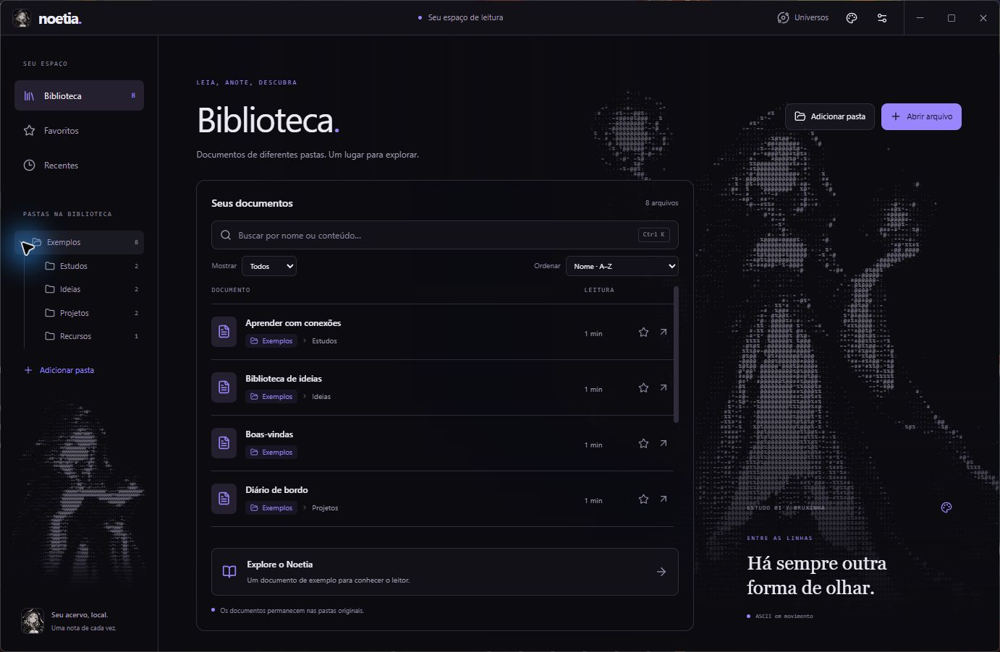
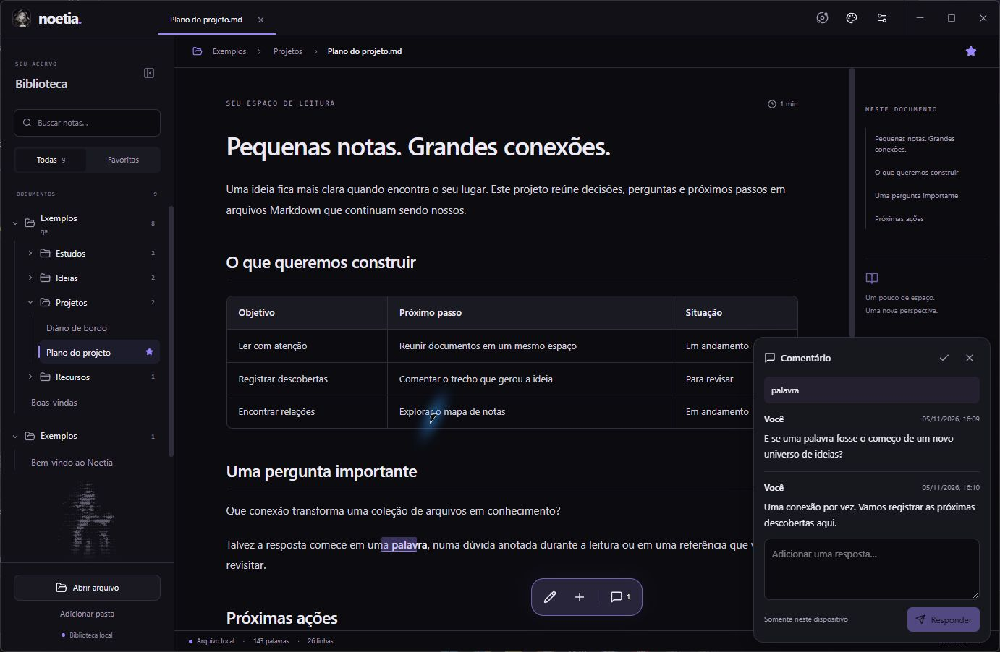
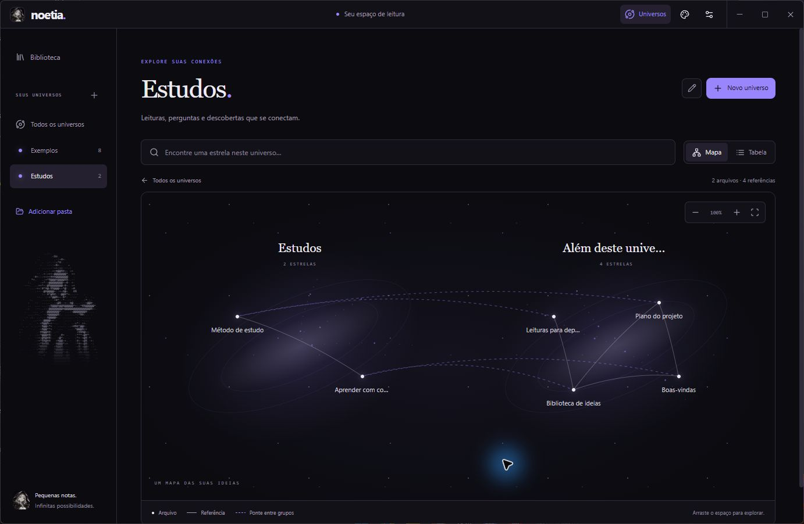
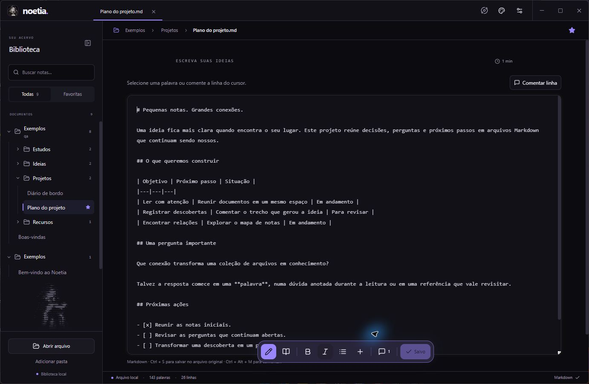
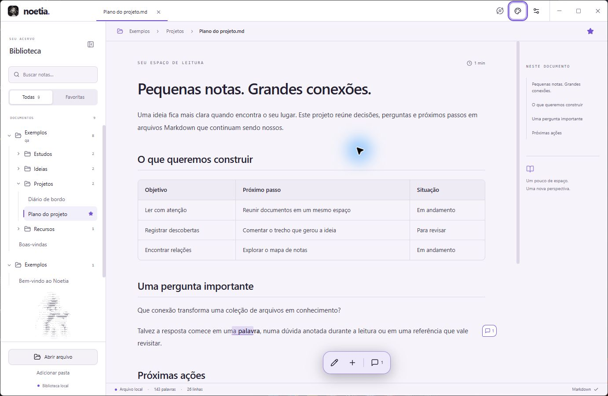
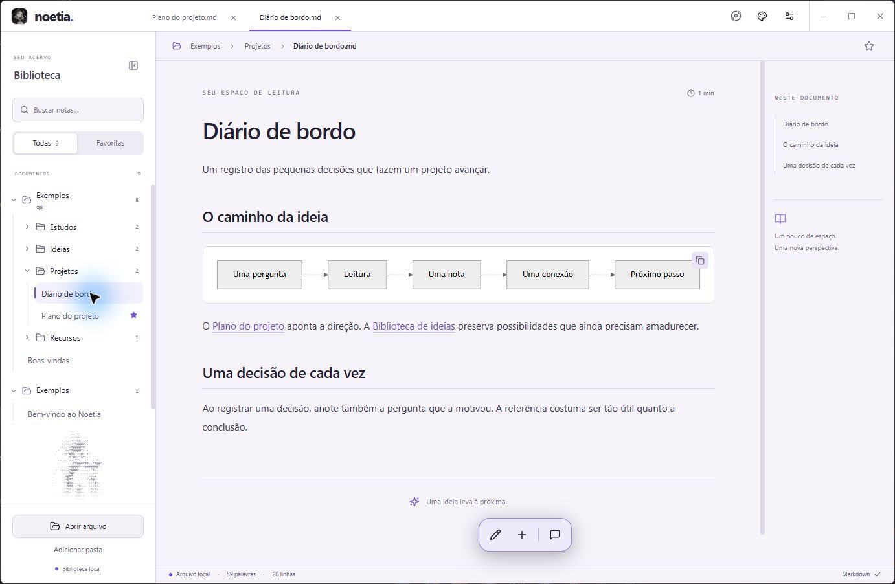

# Noetia

**Leia, escreva e conecte suas ideias.** Um aplicativo desktop para Markdown, com arquivos locais, comentários no texto e universos de notas conectadas.



## Baixar para Windows

Na [página de releases](https://github.com/SirDarky/noetia/releases), escolha:

| Arquivo | Uso |
|---|---|
| `Noetia-0.1.0-windows-x64-setup.exe` | Instalação para seu usuário do Windows |
| `Noetia-0.1.0-windows-x64-portable.zip` | Extraia a pasta completa e abra `Noetia.exe`, sem instalar |
| `SHA256SUMS.txt` | Hashes para conferir a integridade dos downloads |

Requer Windows 10/11 **x64** e Microsoft Edge WebView2 Runtime. O instalador inclui o bootstrapper oficial para obter o runtime, se necessário; essa etapa pode precisar de internet. A versão portátil requer o runtime já instalado. Os binários desta primeira versão ainda não têm assinatura digital.

Na versão portátil, sessão, rascunhos, comentários, biblioteca e backups ficam em **NoetiaData**, ao lado do executável. Feche o aplicativo antes de transportar a pasta inteira. Notas externas continuam nas pastas originais; os exemplos e outras notas dentro da pasta portátil podem acompanhá-la.

## O que já funciona

- Biblioteca com pastas e subpastas, busca por nome/caminho/conteúdo, favoritos e recentes.
- Filtros e ordenação por nome, atualização, tempo de leitura e abertura recente.
- Leitor com abas, índice, tabelas, código e diagramas Mermaid.
- Editor Markdown com prévia, rascunhos locais, Ctrl + S, detecção de conflito e cópia da última versão anterior.
- Comentários em palavras e linhas, marcadores no texto, respostas e resolver/reabrir.
- Universos por pasta ou seleção, referências Markdown/wikilinks, backlinks e navegação por mapa ou tabela.
- Seis temas, artes ASCII com movimento opcional e cabeçalho integrado ao Windows.

### Uma conversa no lugar certo

Selecione uma palavra e clique em **Comentar**. O marcador guarda a conversa junto ao trecho. Se o conteúdo mudar e a referência ficar ambígua, a citação permanece preservada.



### Cada nota, uma estrela

Universos reúnem notas sem mover os arquivos. As linhas do mapa representam referências reconhecidas entre os documentos.



### Do texto à ideia

Escreva em Markdown, confira a prévia e escolha um tema confortável para ler.







## Primeiro uso

1. Abra o aplicativo e escolha **Adicionar pasta** ou **Abrir arquivo**.
2. Para experimentar, use o acervo fictício de `examples/` — `Exemplos/` no ZIP portátil.
3. Clique em uma nota para ler; o lápis abre o editor.
4. Selecione um trecho para comentar ou abra **Universos** para explorar as conexões.

O salvamento desktop grava no Markdown original. Comentários e rascunhos ficam separados, nos dados do Noetia. Veja o [guia de uso](docs/USER_GUIDE.md) e a [privacidade](docs/PRIVACY.md).

## Desenvolvimento

Node.js 22.12+ (24 recomendado), Rust/Cargo estável com alvo MSVC, ferramentas C++ do Visual Studio e WebView2. Consulte os [pré-requisitos oficiais do Tauri](https://v2.tauri.app/start/prerequisites/).

```powershell
git clone https://github.com/SirDarky/noetia.git
cd noetia
npm ci
npm run dev
```

`npm run dev` inicia o aplicativo Tauri. `npm run dev:web` é apenas uma prévia auxiliar: ela importa cópias para o navegador e não grava nos arquivos originais.

```powershell
npm test
npm run test:native -- --release --locked
npm run build:desktop
npm run package:windows -- -SkipBuild
```

O último comando gera instalador, ZIP portátil e hashes em `release/`. `npm run notices` atualiza o inventário de licenças das dependências instaladas.

## Estado da primeira versão

Noetia está em desenvolvimento inicial. A validação e os limites efetivamente conferidos constam no [relatório de testes](docs/TEST_REPORT.md). Esta release é para Windows x64; outras plataformas não foram validadas.

Ainda não há criação de novas notas pelo aplicativo, acompanhamento completo de adições/renomeações/exclusões de arquivos, sincronização, colaboração multiusuário ou áudio. O arquivo ativo é relido periodicamente; mudanças na composição das pastas exigem nova importação. O mapa limita as posições exibidas e mantém a tabela como alternativa.

Sugestões e relatos de problemas são bem-vindos; veja [como contribuir](CONTRIBUTING.md).

## Licenças e créditos

Código sob [MIT](LICENSE), por Marcus Vinicius. As artes são redistribuídas com autorização do responsável e têm condições descritas em [ASSETS.md](ASSETS.md). Dependências mantêm suas próprias licenças: [THIRD_PARTY_NOTICES.md](THIRD_PARTY_NOTICES.md).

Feito com Tauri, Rust, React e TypeScript. O Alethe inspirou a referência estética do ASCII; o renderer e a composição do Noetia são próprios.
