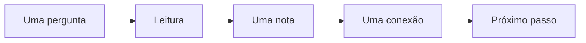

# Diário de bordo

Um registro das pequenas decisões que fazem um projeto avançar.

## O caminho da ideia

O [[Plano do projeto]] aponta a direção. A [[Biblioteca de ideias]] preserva possibilidades que ainda precisam amadurecer.

## Uma decisão de cada vez

Ao registrar uma decisão, anote também a pergunta que a motivou. A referência costuma ser tão útil quanto a conclusão.
