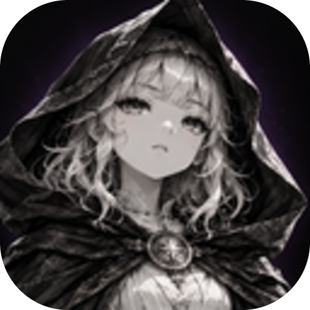

# Imagens que acompanham suas notas

Uma imagem local pode ficar junto do seu acervo. O Noetia resolve o caminho relativo a este documento.

Este retrato é a identidade visual do aplicativo. Veja também [[Boas-vindas]] e [[Biblioteca de ideias]].
